# Envious Glider — Project Ascension progress

Update 4.0 "Ascension" (branch `game-v4`), 4.1 "Ascension II" (branch `game-v4.1`, Phase II below) and
4.2 "Ascension Unleashed" (branch `game-v4.2`, Phase III below).
This file tracks the master directive: what was audited,
what shipped, how it was tested, and what is still to do. Statuses are honest: **Done** means built and
tested, **Partial** means some of it shipped, **Next** means not started.

## Phase III — 4.2 "Ascension Unleashed": evolutions, fusions, Boss Rush, mutations, achievements, events

### What shipped

| Item | Status | Notes |
| --- | --- | --- |
| Weapon evolutions | **Done** | 7 guns × 2 paths (`evolve.js`, `balance.evolution`). A gun at Tier IV evolves after the next sin boss falls; the choice is locked for the run, and "Decide after the next boss" defers it. Every effect is capped, and shots an evolution spawns never trigger evolutions |
| Sin Fusions | **Done** | 7 fusion cards (`fusion.js`, `balance.fusions`): offered once two sins reach level 3. One per run (a second in endless) |
| Boss Rush | **Done** | Unlocks by beating Envy (or any earlier Ladder win, via the save migration). All seven bosses back to back, with a draft, Armory and short break after each; a timer that only runs while you fight; splits against your bests; S/A/B/C ranks; separate records per difficulty; 5 modifiers once cleared; co-op hosts can pick it |
| Elite mutations | **Done** | 7 mutations (`mutations.js`, `balance.mutations`), from wave 8 (a little earlier on Hard and Nightmare, never before wave 6). At most 5 alive, never stacked with the old elite traits, each with its own marker, tell and one-time hint |
| Achievements and cosmetics | **Done** | 34 achievements (`progress.js`) across Combat, Builds, Mastery, Bosses and Progress. They unlock suits, visors, jetpack trails, weapon finishes, titles, badges (pin up to 3) and boss victory effects. The Profile screen has Achievements and a Locker with a live preview |
| Run events | **Done** | Cosmic Cache, Corrupted Armory (6 relics), Sin Altar and Elite Ambush (`events.js`, `balance.events`, `balance.relics`). At most one per chapter from chapter 2 |
| Harder bosses and robots | **Done** | The user asked for harder bosses and tougher robots mid-phase. Boss health, attack pace, shots and minions ramp from Sloth to Envy (`balance.threat`). Bosses have *resolve*, a damage-rate cap so stacked builds can't delete them. Robots get more health per wave, waves are bigger, and elites arrive earlier. Gluttony's slam stops growing at 1.3×, so it can always be outrun |
| Saves | **Done** | Save version 3 with `migrate()`: 4.1 saves keep everything. Earlier Ladder wins open Boss Rush and credit the matching achievements, and achievements you already have pay their Sigils |
| Hats and Sigils | **Done** | Nine hats to buy with Sigils, a rare currency, in the Locker (try one on in the preview first). Swap between owned hats any time; the crown is free and the default, and "No hat" is an option. Co-op teammates see your hat |
| Leaderboards | **Partial** | Ladder runs post as before (difficulty recorded). Boss Rush is scored and stored separately on the device but **not posted online**: that needs a new Supabase table/function outside this repo, so Rush scores can't mix into the Ladder board |
| Download the app | **Done** | A Download button on the game menu (website only; hidden inside the apps) opens "Get the app": the Windows app and the Android app (`assets/game/download/`) with install notes, your own platform listed first, and an Add to Home Screen tip on iPhone and iPad |
| Android app | **Partial** | `EnviousGlider.apk` (Android 7+, landscape, 0.8 MB): the game's files ship inside it and are served to a WebView as https://enviousgluttony.com/game/, like the Windows app, so saves, sign-in, the leaderboard and co-op work as on the site. Back closes panels and pauses; leaving the app pauses a solo run. Built and signed (APK Signature Scheme v2 and v3) and checked with Google's tools, but **not yet run on a phone** |
| Human playtesting | **Next** | Everything below is simulated |

### Weapon evolutions

| Gun | Path A | Path B |
| --- | --- | --- |
| Blaster | **Starbreaker** (precision): +1 pierce, and a bolt that pierces a robot leaves a burning trail. Charged orb implodes, pulling robots in, then bursts | **Phantom Repeater** (accuracy): hits in a row raise fire rate up to +45%, and a miss halves the streak. Every 5th hit fires a homing spectral bolt |
| Scatter | **Supernova** (point blank): pellets that land up close burst. Charged: a cone shockwave that knocks robots back and erases their shots | **Shredder** (crowds): each pellet ricochets once to the nearest robot, +10% crit, and crits throw 3 fragments |
| SMG | **Overdrive** (sustained fire): a meter fills, then gives 3.5 s at ×1.8 fire rate, tighter spread and +1 pierce, then a short overheat. Charged bursts top it up | **Neurotoxin** (corruption): hits stack corruption (max 8). It burns and pulses damage into nearby robots; charged bolts add 2 stacks |
| Rail | **Annihilator** (penetration): the charged beam hits each robot 25% harder than the last (capped). Bolts get +1 pierce and grow with each robot pierced | **Singularity** (positioning): the charged beam's path pulls robots onto it, then fires at ×1.35. Bolts get +1 pierce and tug robots toward the hit |
| Nova | **Cataclysm** (chain blasts): every burst throws 3 bomblets. Charged: a ring of 8 blasts, then a big core blast | **Gravity Well** (control): bursts leave a well (max 10) that pulls robots in; robots inside take 25% more damage. Charged: one huge well |
| Arc | **Thunderlord** (chain lightning): +1 jump, each jump 25% stronger, +8% crit. Crits fork 2 more jumps | **Tempest** (storms): lightning strikes the nearest robot every 1.5 s. The charged orb leaves a storm (max 2) that strikes robots inside for 4 s |
| Heart | **Blood Moon** (marks): darts mark robots for 4 s. A marked robot that dies looses 3 blood darts (max 24 alive) | **Soulbound** (tracking): darts hunt the most dangerous robots first, and hits in a row track harder and fly faster. Charged: 10 hearts, each bound to a different target |

### Sin Fusions

| Fusion | Sins | Effect |
| --- | --- | --- |
| Covetous King | Greed + Envy | Kills during a stolen power drop 2 bonus stars. Each star grabbed stretches stolen powers by ½ s, up to double their time |
| Bloodlust | Wrath + Lust | Charmed robots grow more vicious the longer they serve (up to double damage and speed). When the charm ends they erupt in a bigger blast and a ring of 8 blood shots |
| Immortal Feast | Gluttony + Pride | Crit kills count 3 toward Gluttony's heal, with 2 more heals a wave. A heal at full health "gorges" (3 stored): the next crit hits twice as hard and bursts |
| Frozen Judgment | Sloth + Pride | Crits on slowed robots shatter, hurting and freezing robots nearby. A perfect boost readies Judgment: the next shot is a piercing crit, 50% harder |
| Golden Frenzy | Greed + Wrath | Each star grabbed gives +1% damage and fire rate (up to +25%, fading). At 25 stacks: 4 s of +40% damage and golden kill bursts (once per 10 s) |
| Parasitic Heart | Lust + Gluttony | Every 12 hits charmed robots land heals ½ heart (2 a wave). Each charm that ends gives a shield pip (3 a wave) |
| Stolen Time | Envy + Sloth | During a stolen power, hits slow robots by 30%. Perfect boosts add 2 s to stolen powers (3 times each) |

### Boss Rush

- **Unlock:** beat Envy on the Ladder (or clear the Rush). The menu button shows "locked" until then.
- **Flow:**
  - A 4-card opening draft with ★130.
  - After each boss: 3 picks, +★55, two hearts back and the Armory (Sealed Armory: every other boss).
  - +1 max heart for the whole Rush.
  - Bosses at 80% of their Ladder health, with plain minions.
  - The clock pauses between fights.
- **Score:** the Rush has its own score and is never mixed with the Ladder's.
  - Kills.
  - A time bonus of 30,000 − 25 per second.
  - +1,500 for each boss beaten without a hit.
  - Each modifier adds 15–20%.
- **Rank:** S/A/B/C by fighting time (par 240/330/450/600 s on Normal, ×1.15 on Hard and ×1.3 on Nightmare). Every 8 hits costs a grade.
- **Records:** best time, rank and score per difficulty, and best split per boss. Splits show live against your bests.
- **Modifiers** (after the first clear): Starved, Bullet Hell, Sealed Armory, Entourage, Fury.
- **Co-op:** the host picks Ladder or Boss Rush in the lobby, and both players get the results screen.

### Elite mutations

| Mutation | From wave | Trick | Counter |
| --- | --- | --- | --- |
| Volatile | 8 | Bursts on death (ring telegraph) | Leave the ring, or kill it next to its friends |
| Berserker | 8 | Below half health: faster, attacks more often | Finish it quickly |
| Armored | 13 | Front plates (×0.4 damage), glowing weak spot behind (×1.6) | Get round it |
| Shockwave | 13 | Telegraphed rings | Step out of reach or boost through |
| Phantom | 18 | Shimmers, phases out, blinks to your side | Track the shimmer |
| Vampiric | 18 | Heals from every hit it lands on you | Don't trade blows |
| Replicator | 23 | Copies itself when wounded (twice at most) | Burst it down |

### Achievements and cosmetics

- **34 achievements:**
  - Combat (7): Untouchable, Matador, Ghost in the Machine, Dead Eye, Overkill, Combo Fiend, Mutant Hunter.
  - Builds (7): Sin Incarnate, All Seven, Fused, Unholy Union, Evolved, Ascendant Arsenal, Every Path.
  - Mastery (7): beat the Ladder with each gun as your top damage source.
  - Bosses (5): Rude Awakening, Diet Plan, Crown Breaker, Keep Calm, Mirror Mirror.
  - Progress (8): Ladder Climber, Hardened, Nightmare Walker, The Gauntlet, Speed Demon, Personal Best, Beyond the Ladder, Daily Grind.
- **Rewards:** 5 new suits (Laureate, Obsidian, Nightmare, Seven Sins, Unholy), visors, jetpack trails, weapon finishes, titles, badges and boss victory effects.
- **Display:** they show in the Locker. Each locked item names the achievement that unlocks it.
- **Co-op:** teammates see your suit. Other cosmetics are local only.

### Hats and Sigils

Sigils (`balance.sigils`) never drop in debug runs. Payouts are multiplied by difficulty (Normal ×1, Hard ×2, Nightmare ×3) except achievements:

| Source | Sigils (Normal) |
| --- | --- |
| Each sin boss beaten on the Ladder (endless laps too) | 1 |
| Beating the Ladder | 5 |
| Clearing Boss Rush | 3, plus 3 for an S rank or 1 for an A |
| Each achievement (once) | 2 |

A Normal Ladder win pays about 12, a Nightmare one about 36. Co-op guests are paid from the host's messages, the same amounts.

| Hat | Price |
| --- | --- |
| Crown (default) | Free |
| No hat | Free |
| Sloth's Nightcap | 30 |
| Gluttony's Toque | 40 |
| Greed's Top Hat | 50 |
| Lust's Heart Boppers | 50 |
| Wrath's Horns | 70 |
| Pride's Laurels | 80 |
| Envy's Serpent | 100 |
| Machine Antenna | 120 |
| Halo | 200 |

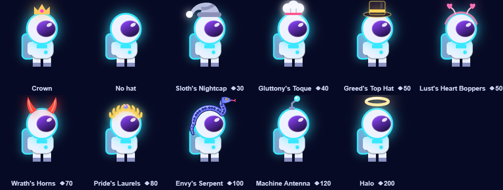

### Run events

- **Cosmic Cache:** a passive cache drifts across mid-wave. Crack it before it leaves for stars or a free rare-or-better Armory item.
- **Corrupted Armory:** choose 1 of 3 relics, each with a strength and a cost, or walk away. The 6 relics are Blood Pact, Overclocked Core, Greedy Gears, Hollow Crown, Glass Halo and Leaden Wings. They show in the Armory as Corrupted rarity.
- **Sin Altar:**
  - Offer stars for +1 to your top sin.
  - Pay to raise a sin to level 3, so its fusion is offered next.
  - Transmute a level from one sin to another for free.
- **Elite Ambush:**
  - Accept, and 3 mutated hunters wait in the next wave.
  - Kill them all within 25 s for stars and an extra card.
  - Fail, and they keep hunting you.

### Balance data (autopilot: sees every shot, perfect aim, so it understates difficulty for people)

| | 4.1 | 4.2 |
| --- | --- | --- |
| High-damage build, Normal | Won, 6 hits; boss fights 4–13 s | Won, 31 hits; boss fights 30–65 s |
| Random build, Normal | Won, 21 hits | Wave 34 with ~21 hits |
| High-damage build, Hard | Died w15, won (14 hits) | Died w10, won (12 hits) |
| Random build, Nightmare | Died w5, w6, won (15 hits) | Won, 57 hits; Envy 122 s |
| High-damage build, Nightmare | | Died w13 (after Gluttony) |
| Boss Rush, high-damage build | | Cleared (C rank, 256 s, 26 hits); died to Greed once |
| Boss Rush, random build | | Died to Wrath |

- **Tank builds:** defensive builds still finish, but late Bulwark and Patch Bot waves (wave 31+) are slow for them.
- **Co-op:**
  - A two-autopilot co-op Ladder reached wave 26. The guest evolved Phantom Repeater and took Bloodlust, and mutations, zones and status effects synced.
  - A co-op Boss Rush with Bullet Hell (god mode, to test the flow) reached the results screen on both clients.
  - Neither run had console errors.

### Performance (same machine, High)

| | 4.1 | 4.2 |
| --- | --- | --- |
| Frozen scene, 63 robots: draw | 0.567 ms | 0.564 ms |
| Same scene: one simulation step (warm) | 0.040 ms | 0.032 ms |
| Gravity Well stress (7 wells over a crowd): draw | | 1.43 ms |

- **Zones:** one pooled list (160 max), drawn in two passes, with per-player caps.
- **Mutation checks:** they run only on mutated robots.
- **Volley tracking:** fixed-size typed arrays.
- **New sprites:** pre-rendered like the rest.

### Tests

`?debug=1&tests=1` runs 40 deterministic checks (`tests.js`). They cover:
- **Fusions:** offer rules, one per run, and every cap.
- **Evolutions:** every evolution cap, and that kin shots never retrigger.
- **Mutations:** caps and minimum wave, plus the Armored multipliers.
- **Boss resolve:** the damage-rate cap.
- **Boss Rush:** ranks.
- **Hats and Sigils:** prices, owning and wearing, no earning in debug runs, and the difficulty multiplier.
- **Saves:** 4.1 → v3 migration, including Sigils for past achievements.

All pass.

**Soak runs:** autopilot Ladder runs on all three difficulties, Boss Rush solo and co-op, and a co-op Ladder. None had console errors.

### Screenshots (`?debug=1`; the profile and Boss Rush records come from a seeded test save)

| | |
| --- | --- |
| 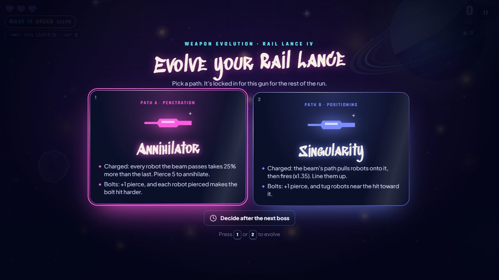 Weapon evolution choice | 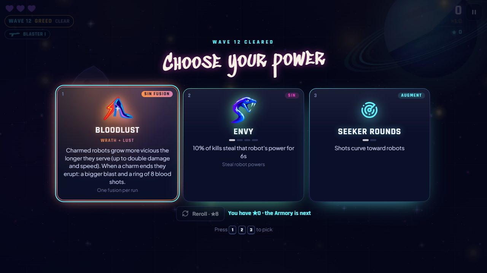 A Sin Fusion card |
| 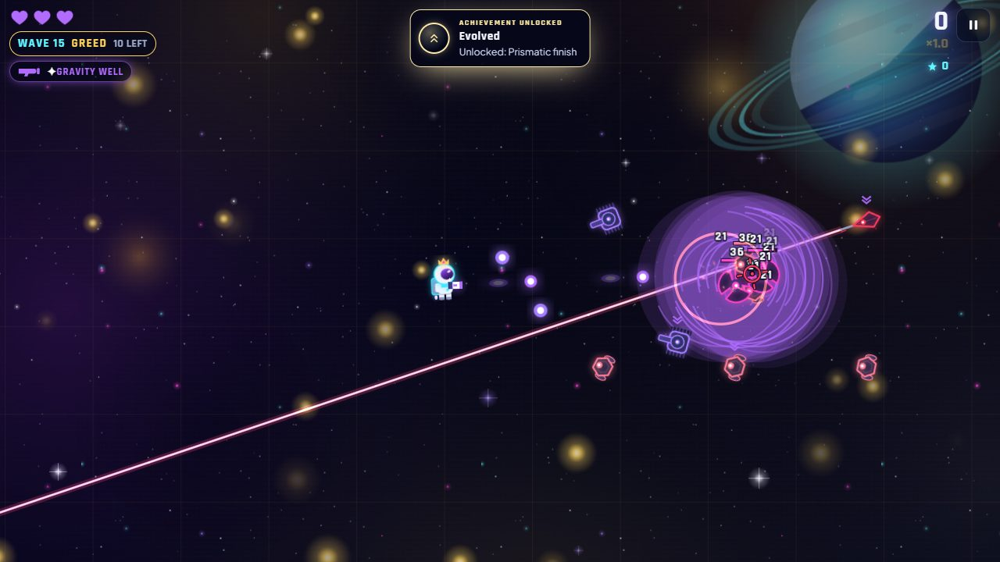 Gravity Well, with an achievement popup | 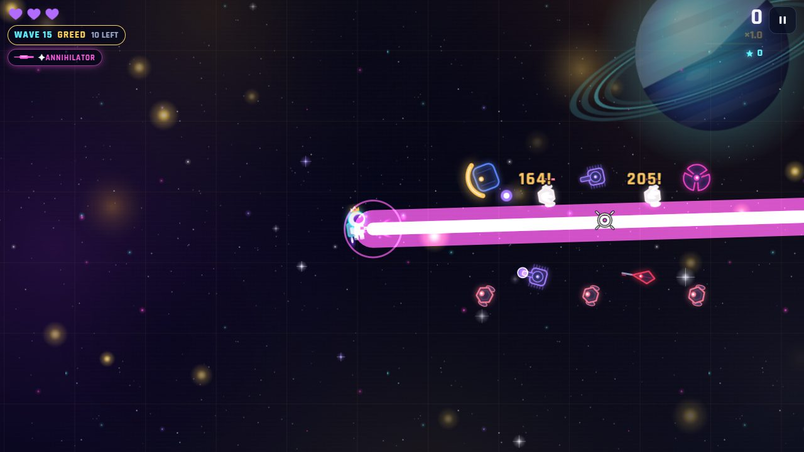 Annihilator charged beam |
| 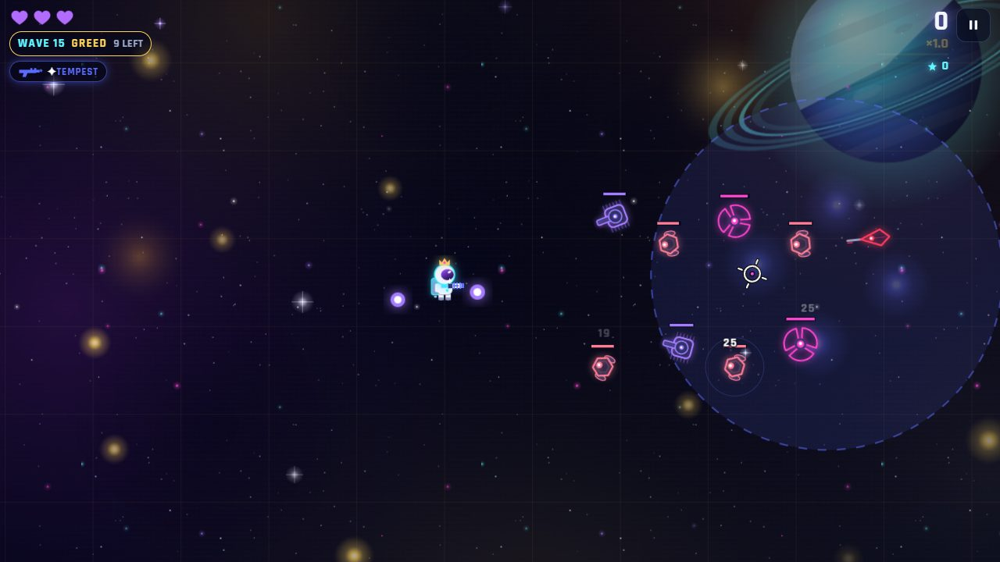 Tempest storm | 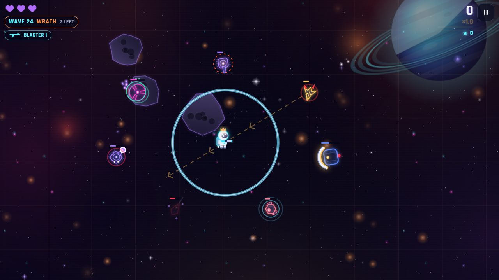 Mutated robots |
| 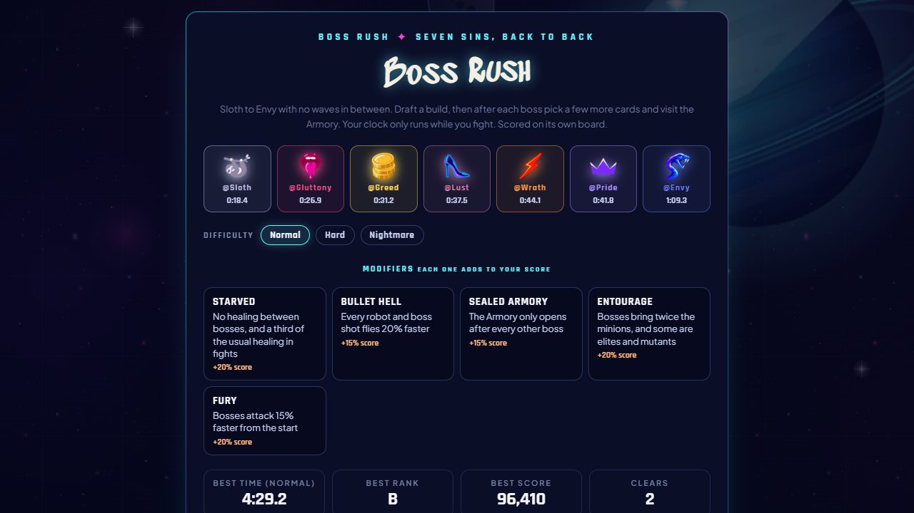 Boss Rush setup | 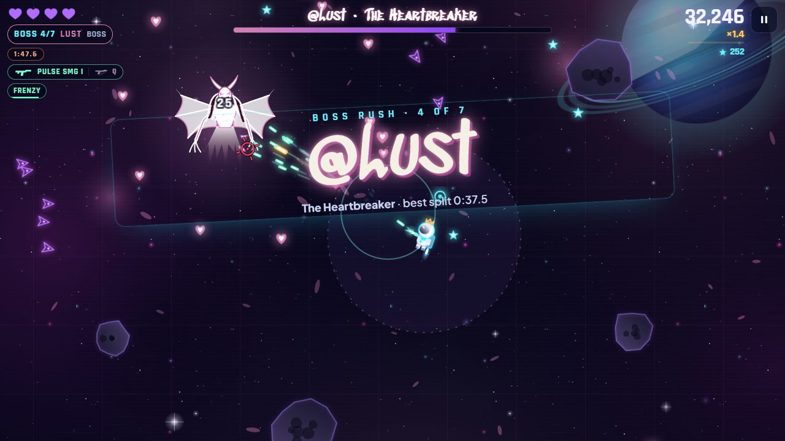 Boss Rush fight (HUD timer) |
| 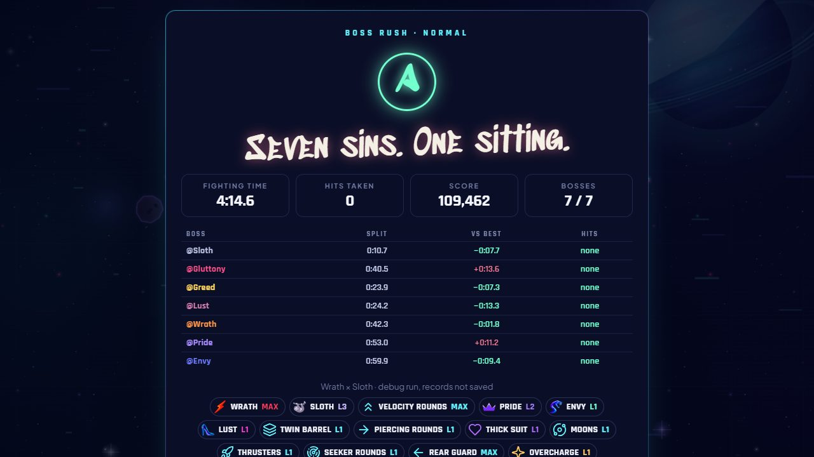 Boss Rush results | 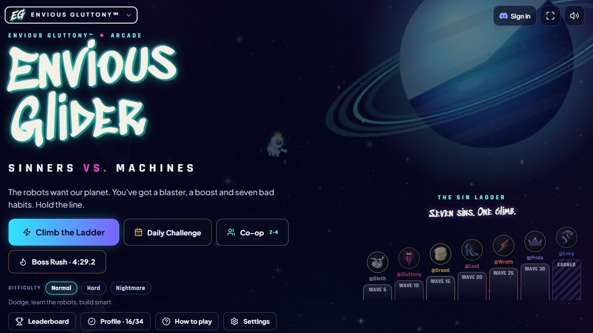 Menu |
| 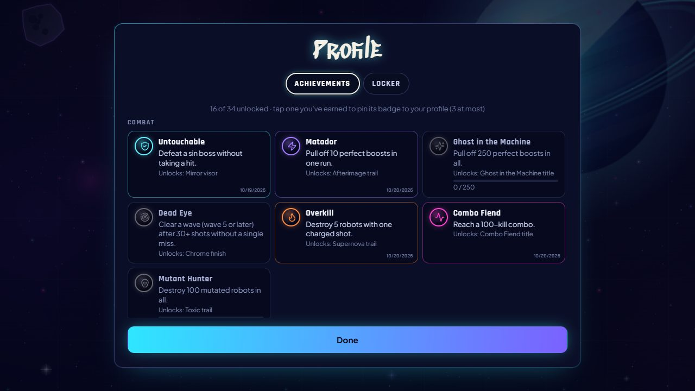 Achievements | 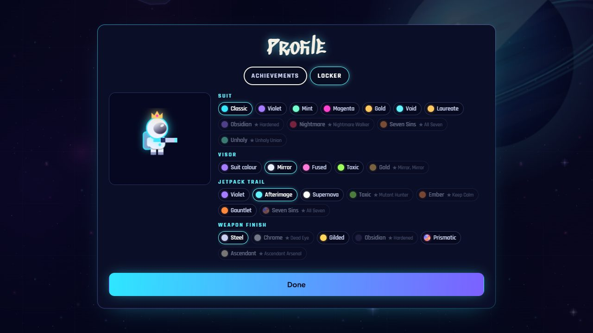 Locker |
| 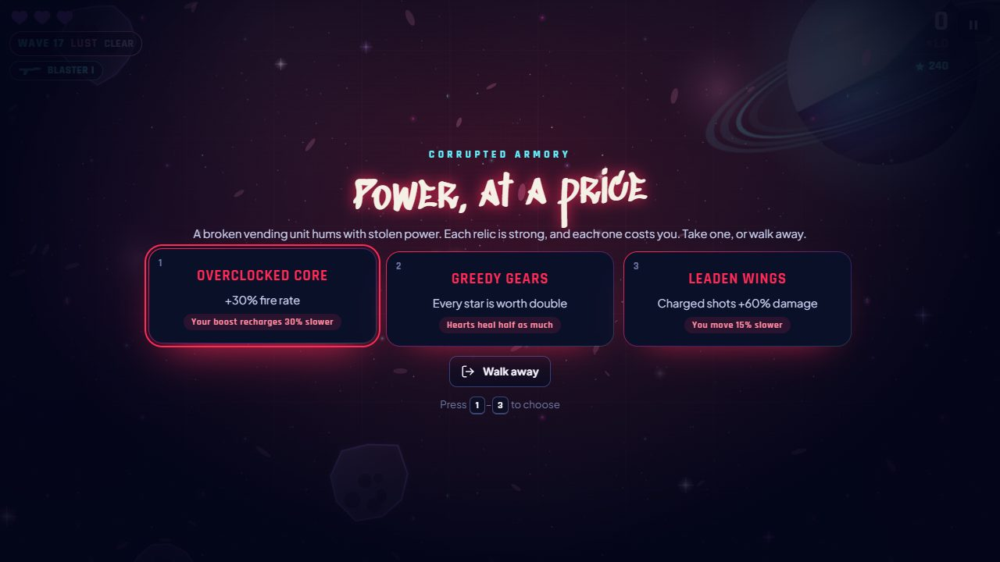 Corrupted Armory | 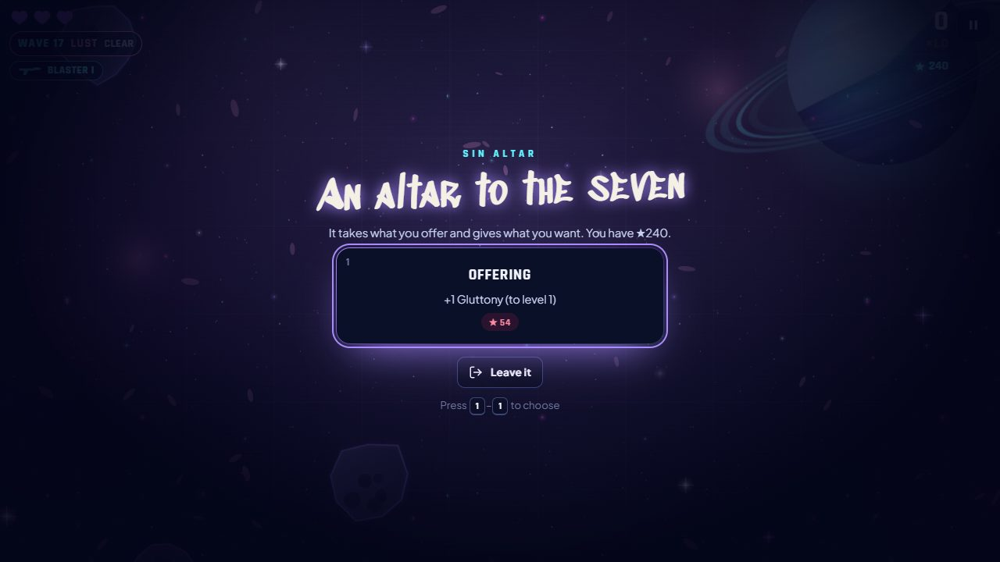 Sin Altar |
| 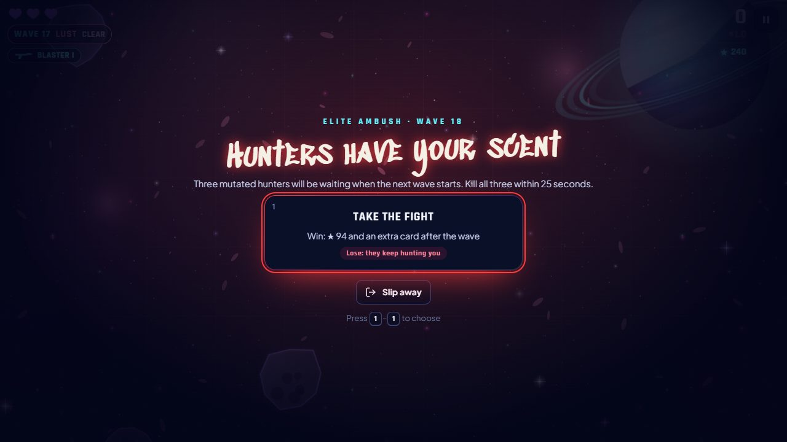 Elite Ambush | 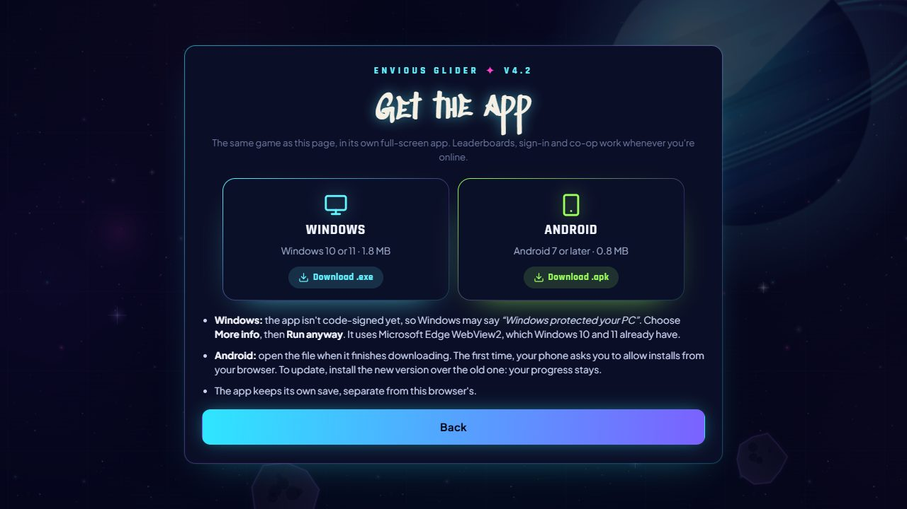 Get the app |
| 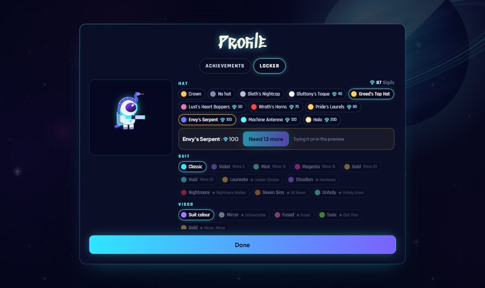 Hats in the Locker (trying one on) | |

### Known limits

- **No human playtest yet.** The autopilot dodges better than people, so real difficulty is higher than the table suggests.
- **Boss Rush scores stay on the device.** An online Rush board needs a server change.
- **Co-op tracking:** a few achievements (boss conditions, Rush clears) are tracked on the host only.
- **Low-damage builds:** they face long late waves (Bulwark and Patch Bot squads).
- **Unholy Union and Every Path** span many runs by design. They can't be earned quickly.
- **Android app:**
  - Not yet tested on a real phone.
  - Google sign-in refuses to run inside apps, so sign in with Discord there.
  - Android's installer warns about apps from outside the Play Store.
- **Windows app:** not code-signed, so SmartScreen warns on first run.
- **App signing key:** the Android key (`%USERPROFILE%\.android\envious-glider-release.jks` and its `.pass` file) must be kept. Updates signed with any other key won't install over this version.

## Phase II — 4.1 "Ascension II": challenge, visual refinement, Greed's music

### Audit: why it was too easy

| Found | Evidence | Action |
| --- | --- | --- |
| Robots aimed at where you *are* | Every gunner, sniper, ripper and drone used the angle to your current position, so constant movement dodged everything | Lead aim (by Mark and difficulty): they aim where you're heading; changing direction after they commit dodges |
| Chasers trailed you | Pursuit targeted your position | Intercept pursuit, a share of flankers, encircling swarms |
| No coordination | Random spawn mix, gunners clumped, no protection | Crossfire bearings for gunners, bulwark escorts, patch bots hide, squads in waves |
| Multiplicative power stacking | Autopilot "high damage" build: 35 dmg × 7/s × 5 homing projectiles × 35% crit ×3, charged shots ×3.75 firing twice; Pride (13.4k HP) died in **1 s** | Extra barrels share damage (+60% each), weaker Seeker Rounds, trimmed charge stack / Overdrive echo / Pride / Wrath / Heartseeker |
| Generous sustain | Gluttony L4 healed every 5 kills with no cap; 2.5% heart drops; 1.1 s invulnerability | Gluttony heals capped per wave, fewer hearts, 0.95 s invulnerability (× difficulty) |
| Crowd-control lock | Lust's charm (15% per hit) on a fast gun charmed nearly everything | Charm holds 2–6 robots at once |
| Infinite boss fight | A low-damage build could never kill Gluttony (it heals from minions): 5,879 s in one test | Meals heal less each time, max 40% back per fight |
| Bosses barely threatened | 0–1 hits per boss fight on the autopilot | New attacks / sharper second phases for all seven (below) |

### What shipped

| Item | Status | Notes |
| --- | --- | --- |
| Difficulty modes | **Done** | Normal / Hard / Nightmare (`balance.difficulty`): aggression, aim lead, invulnerability, crowd size, elites, earlier Marks, boss pace, healing, shot speed, squads. Score ×1 / ×1.3 / ×1.7. Daily is always Normal; co-op uses the host's (tested). Recorded in the leaderboard run's `p_build.difficulty` |
| Smarter robots | **Done** | `enemies/roster.js`: `leadAngle`, intercept `chase`, flankers, swarm ring, gunner crossfire, bulwark escort, patch cover, boomer sprint, sniper relocation, `urge` (faster while your boost recharges) |
| Squads | **Done** | `balance.waves.squads`: phalanx, demolition, pincer, artillery, field medic, hunters, fortress |
| Boss pressure | **Done** | Sloth reach + snore + offset rings; Gluttony heal cap + double slam; Greed gold rain + cash-out ring; Lust heart rings while luring; Wrath leading dashes + burst, shield pulses; Pride shooting gems + twin decree + double kneel; Envy leads shots, boost lands in a ring |
| Survivability audit | **Done** | See audit. Defensive builds still finish runs (autopilot "tank" won Normal with 6 hits) |
| Greed soundtrack | **Done** | G harmonic minor, 96 bpm swing chapter / 112 bpm boss, "vault" kit (coins on steel), dark stabs, cat-and-mouse lead. Measured: chapter centroid 229 → ~150 Hz, energy above 3 kHz 0.8% → 0.2%, loudness matched to the other themes |
| Visual polish | **Done** | Jet flame, boost squash, visor glint, muzzle flash, shot trails, robot hit pop + idle breath, damage sparks, boss entrance bars + shockwave, phase-change moments, boss damage smoke, planet lighting, nebula dust lanes, twinkling stars, card sheen, button/panel motion. Art untouched otherwise |
| Leaderboards by difficulty | **Partial** | The leaderboard SQL lives in Supabase (outside this repo) and only splits by Daily. Difficulty is sent with each run and scores are multiplied; a per-difficulty board needs a server change |
| Human playtesting | **Next** | Everything below is simulated |

### Balance data (autopilot: sees every shot, perfect aim, so it understates difficulty for people)

| | v4 | 4.1 Normal | 4.1 Hard | 4.1 Nightmare |
| --- | --- | --- | --- | --- |
| Random build | Won, 11 hits | Won, 21 hits | Died w10, died w15, won (40 hits) | Died w5, died w6, won (15 hits) |
| High-damage build | Won, 9 hits; bosses 1–22 s | Died w15, won (14 hits); bosses 4–13 s, Envy 55 s | | |
| Crowd-control build | Died w30 once | Died w30 (Pride), won | | |
| Defensive build | (not run with this profile) | Won, 6 hits; Envy 153 s | | |

Boss fights for a random build on Normal (two runs): Sloth 13–24 s, Gluttony 20–31, Greed 33–45, Lust 12–36, Wrath 24–32, Pride 18–25, Envy 59–69 (measured before Envy's base health was trimmed from 7,500 to 6,800).

### Performance (same machine, 977×846, High)

| | v4 | 4.1 |
| --- | --- | --- |
| Busy wave 28 (autopilot): average work per frame | 1.40 ms | 1.60 ms (99 robot shots on screen vs 55) |
| Worst half-second | 2.52 ms | 2.12 ms |
| Frozen scene (render only) | 0.37 ms | 0.51 ms |
| Long tasks | 0 | 0 |

### Before / after (same frozen debug scene, `?debug=1&scene=combat|greed|wrath`)

| Before (v4) | After (4.1) |
| --- | --- |
| 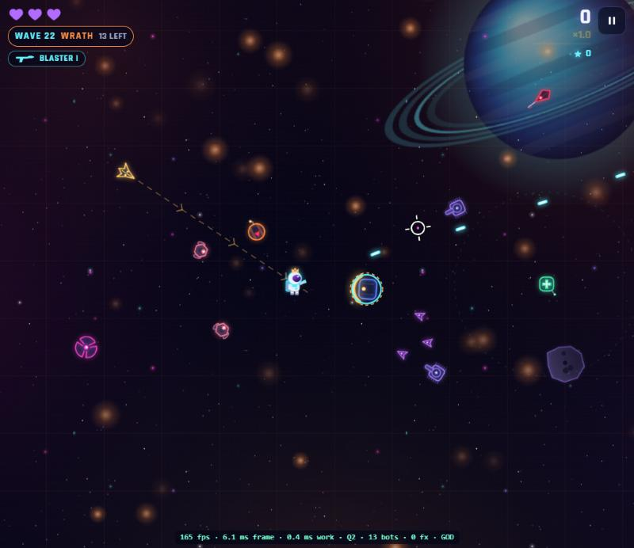 | 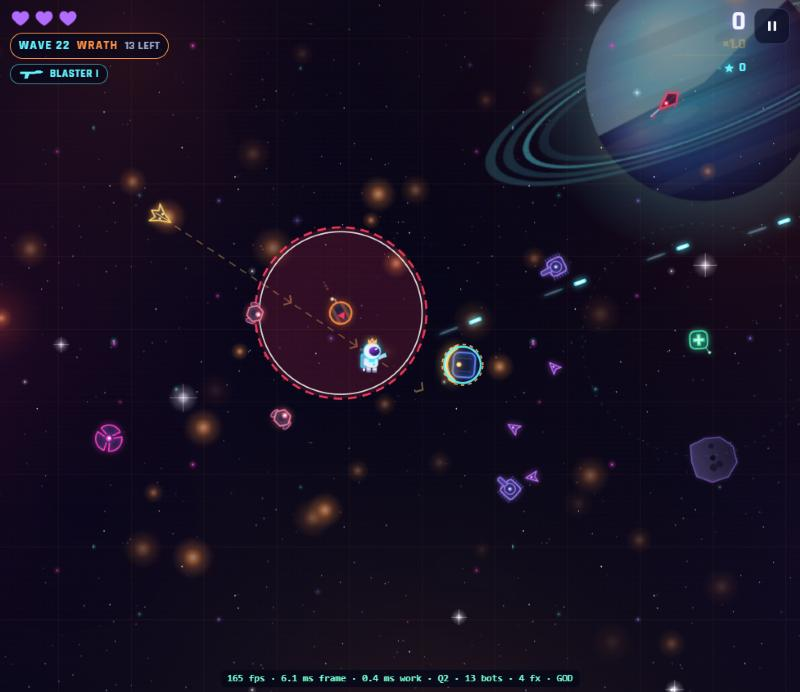 |
| 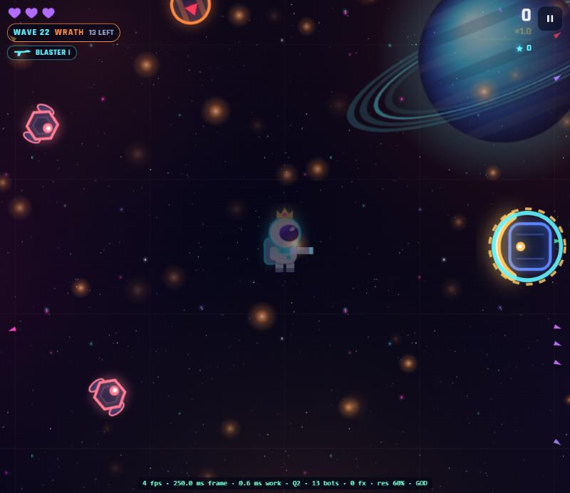 | 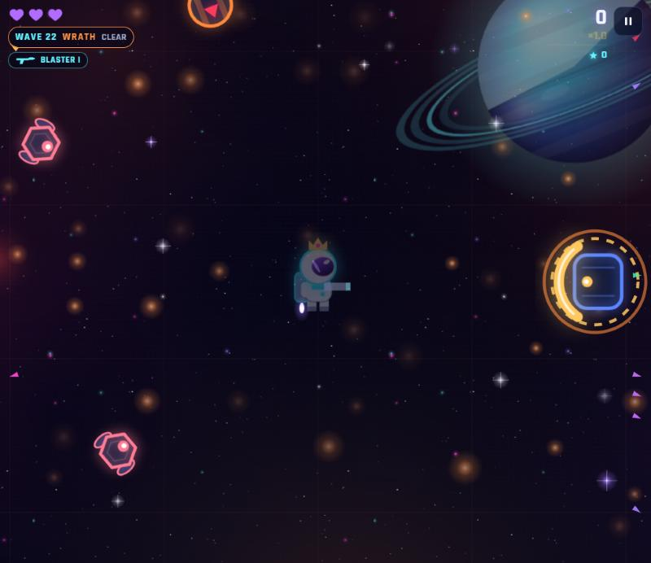 |
| 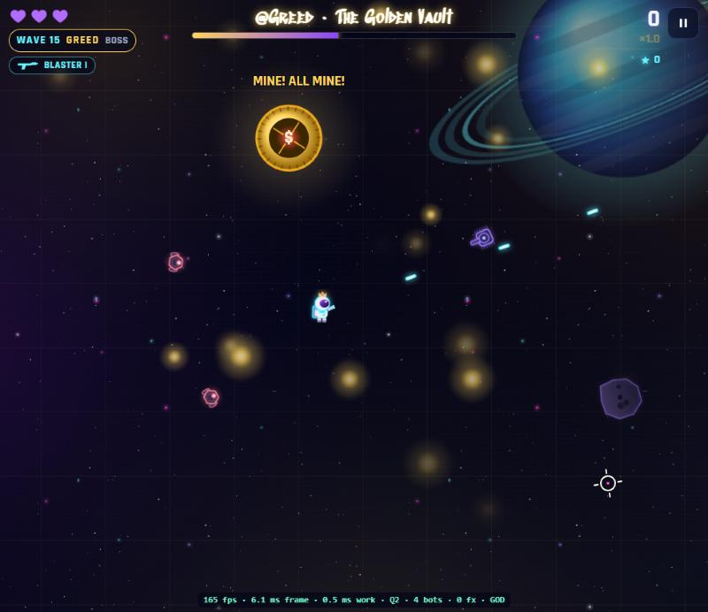 | 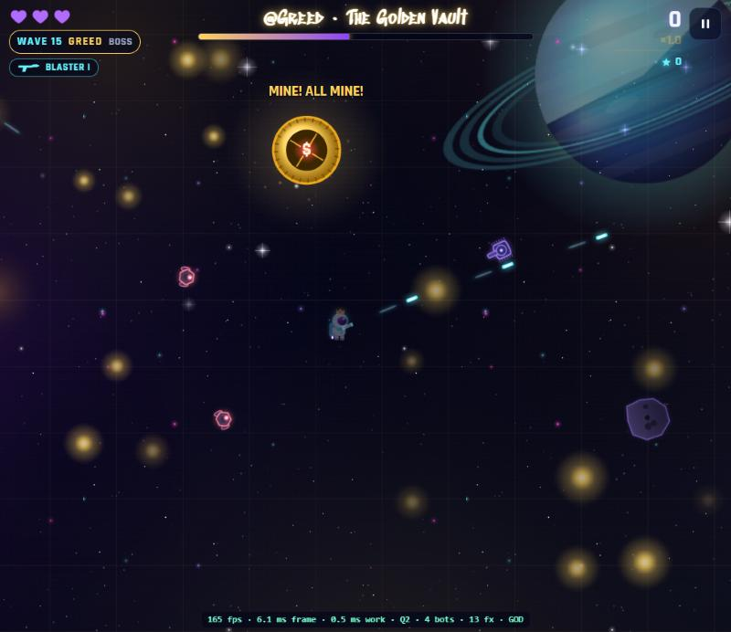 |
| 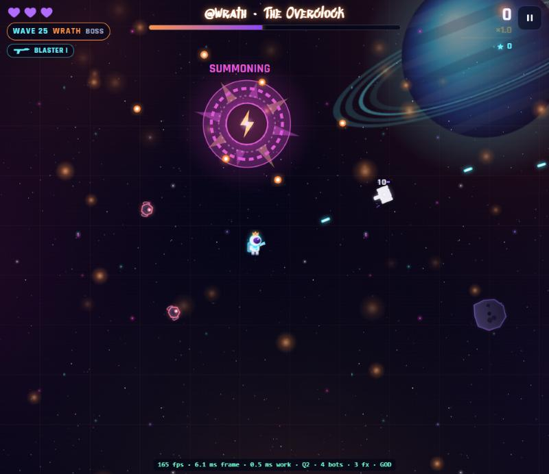 | 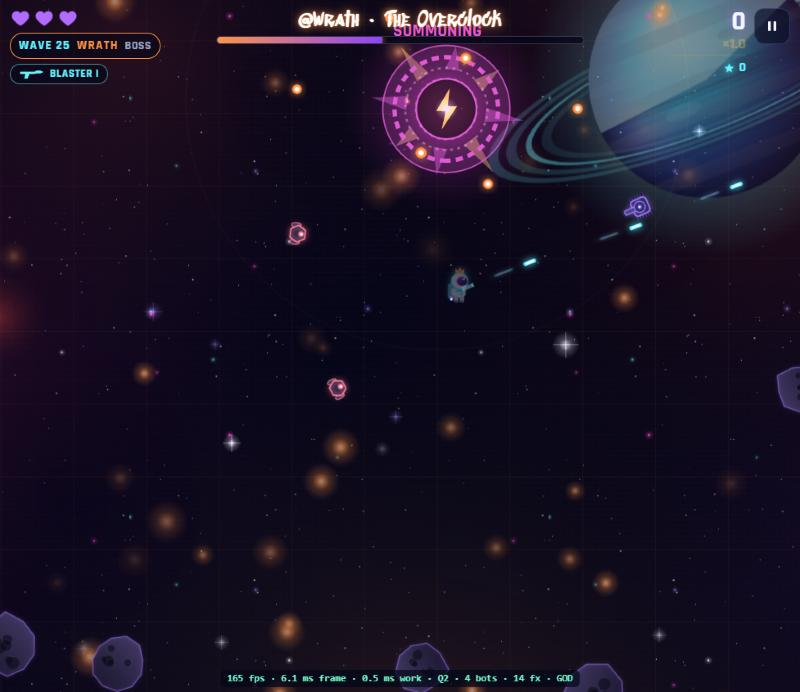 |
| 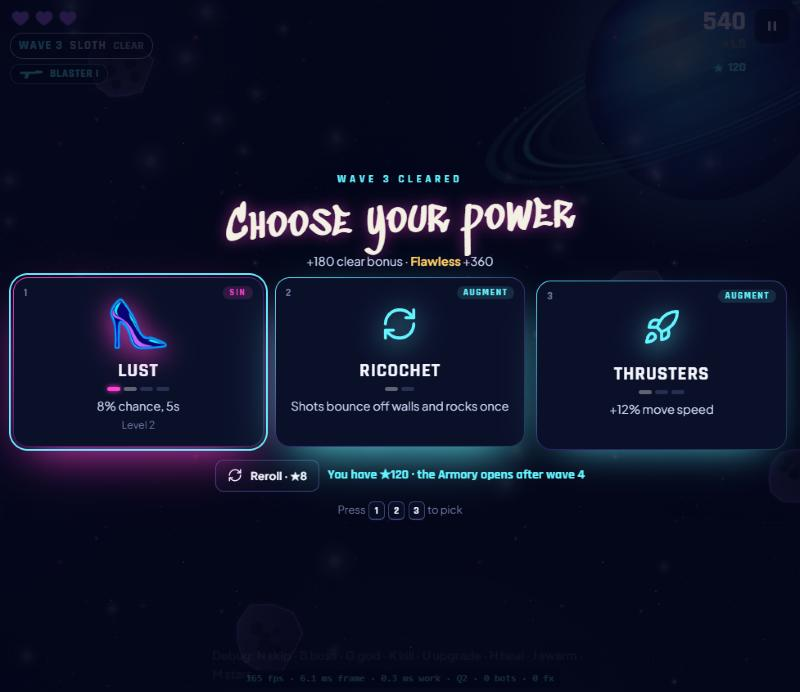 | 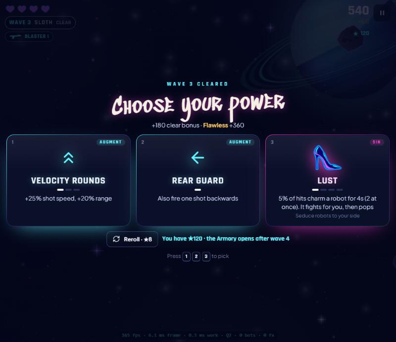 |

### Testing tools added (debug only)

`?bot=dps|tank|cc|weak` build profiles with per-run metrics (`__bot.runs`, `__bot.fights`), a headless loop that
runs at full speed in background tabs, `?diff=` for difficulty, `?scene=` frozen screenshot scenes, `?zoom=` close-ups.

### Known limits

- No human playtest yet; the autopilot dodges better than any person.
- Late fights for low-damage builds are long (Envy up to ~150 s for a pure defensive build).
- Per-difficulty leaderboards need the Supabase function changed.

## Audit (before changes)

| Area | Found | Action |
| --- | --- | --- |
| Boss health | `spawnEnemy` raised boss HP to "your build's DPS × fightSecs", so stronger builds never killed bosses faster | Removed. Boss HP = boss × rung × lap × crew, never your build |
| Between waves | Card pick **and** the Armory after every wave (two stops, every wave) | Armory after waves 2 and 4 of each chapter and after every boss (3 of 5 waves) |
| Wave 12 | "Robots evolved" and the elite warning were separate pop-ups that overlapped | One wave intro, lines joined |
| Envy | "IT COPIED YOUR POWER" floating text duplicated the steal telegraph | Line removed |
| Version | Client posted `web-2.0`, the menu said v3.0, the import map used `?v=4` | One source: `js/version.js` (4.0 "Ascension"), modules at `?v=5` |
| Music | One procedural loop for the whole game, created nodes per note | New engine (`js/music.js`), see below |
| Crosshair | Fixed cyan ring, vanished on bright explosions and cyan bullets | Auto (inverting) + colours, size, style, outline, red-on-target |
| Leaderboard keys | Game code uses the site's anon Supabase client only, no privileged keys | No change needed |
| Perf | Per-frame `setLineDash([..])` array allocations (~0.6 MB/s churn), sprites rebuilt at render resolution, Auto quality only dropped effects | Cached dash arrays, sprite "art scale", dynamic resolution, device-based start |

## Milestones

| # | Directive item | Status | Notes |
| --- | --- | --- | --- |
| 1 | Remove the boss DPS health floor | **Done** | Retuned with a convex rung curve (`ladder.rungHp2`), Pride's crown (gems 300 HP, humbled ×1.6), Envy 9000 base |
| 2 | Boss music per Sin | **Done** | 7 boss arrangements + 7 chapter themes + menu, adaptive intensity 0–4 |
| 3 | Crosshair visibility / options | **Done** | Settings → Gameplay → Crosshair, live preview on dark and bright |
| 4 | Between-wave flow, SIN / AUGMENT / EQUIPMENT / WEAPON terms | **Done** | Armory cadence `shop.openAfter: [2, 4, 5]`; boss bounty (one Epic+ offer, a free reroll); card tags "Sin" / "Augment"; offers "<Rarity> equipment" |
| 5 | Wave-12 message overlap | **Done** | |
| 6 | Chapter art direction | **Done** | Per-chapter nebula, grid tint, arena corners, ambient motes (dust, spores, glints, rose petals, embers, crystals, shards) |
| 7 | Damage direction + cause of death | **Done** | Red arc toward the hit; "Got you" on the summary; synced in co-op |
| 8 | End-of-run summary | **Done** | Damage dealt, biggest hit, top gun, stars spent, what got you |
| 9 | Perfect boost polish | **Done** | Music duck, violet ring, radial sparks |
| 10 | Synergy hints | **Done** | `js/synergy.js`: chips on cards and Armory offers when they combo with what you have |
| 11 | Version unification | **Done** | `js/version.js` feeds the menu and the leaderboard `p_client` |
| 12 | Performance | **Done** | See Performance below |
| 13 | Co-op fairness | **Partial** | Boss HP never reads anyone's build; card-only waves wait for everyone; hit arcs sync. No per-player loot split changes |
| 14 | Boss refinement | **Partial** | Health retune, Envy text fix. No new attacks this update |
| 15 | Weapon refinement | **Next** | |
| 16 | Accessibility | **Partial** | Crosshair options. Key remapping and UI scale are next |
| 17 | Boss Practice / Boss Rush | **Next** | |
| 18 | Achievements, cosmetics | **Next** | Suits by best wave already exist |
| 19 | Leaderboard integrity (server side) | **Next** | Client is clean; plausibility checks belong in the Supabase function |
| 20 | Endless: nothing left to pick | **Done** | Every Sin and Augment maxed: the card screen is skipped. Armory sold out (both guns Tier IV, all gear maxed): skipped unless you're hurt (it still opens to patch you up). Empty offer slots fall back to other rarities, then to a gun |

## Music engine (`js/music.js`)

- One fixed graph built once: bass (2 osc → filter → drive → amp, sidechain pump), pad (3 × 2 osc),
  two arps (Envy mirrors), lead (2 osc + vibrato), kick, snare + body, hats, toms, perc, crash and a
  riser, all fed by one looped noise buffer. A note is a few AudioParam changes; no nodes are created
  while music plays. The whole graph is torn down when music is muted or at 0 volume.
- Lookahead sequencer (25 ms timer, 120 ms ahead). Theme changes land on a bar line.
- Intensity: 0 calm (menus, cards, Armory), 1 combat, 2 high threat (crowded arena, low health, boss
  incoming), 3 boss arrangement + lead, 4 boss below half health (drive, double hats, lead up an octave).
  Envy's lead steals every other boss's melody at intensity 4.
- Riser into a boss entrance, impact on the reveal, duck on a perfect boost, muffle while paused.
- It is procedural synthesis, not produced/recorded tracks.

## Performance

- Fixed 60 Hz simulation, pooled objects, spatial hash, pre-rendered sprites (unchanged).
- Sprites, star tiles and the planet render at an "art scale" independent of the render resolution,
  so lowering resolution no longer rebuilds or blurs them.
- Auto quality: the device picks a starting preset (CPU cores, memory, touch screen); then two slow
  windows lower the render resolution first (down to 60%) when the GPU is the bottleneck, and only then
  effects. Eight fast windows step back up. The FPS readout shows `res N%` when it is scaled.
- `setLineDash` uses cached arrays (`util.dash`) instead of a new array per call per frame.

## Tests run

- Headless autopilot (`?debug=1&headless=1&autoplay=1&god=1&speed=8`): full ladder to the win screen,
  boss fight timings logged per boss (see Balance data). No console errors.
- Music: every theme × part × intensity rendered through an analyser in the browser (non-silent
  output, no errors), duck / riser / impact / muffle, stop tears the graph down.
- Crosshair settings: every control present, custom colour row toggles, preview draws.
- Co-op two-tab smoke (`?cohost=2` / `?cojoin=CODE`), desktop exe `--selftest`, `--selftest-join`.

## Balance data (autopilot, random builds, perfect aim)

Fight seconds before the retune (no DPS floor), 4 runs: Sloth 6–12, Gluttony 8–27, Greed 11–38,
Lust 9–16, Wrath 15–25, Pride 4–7, Envy 5–38. Pride and Envy were far too short.

After the retune (steeper rung curve, Pride's crown, Envy 9000 base), 2 runs:

| Boss | HP (solo, lap 1) | Weak build (s) | Strong build (s) |
| --- | --- | --- | --- |
| Sloth | 950 | 12 | 9 |
| Gluttony | 2375 | 24 | 14 |
| Greed | 3625 (was 4060 in this run) | 41 | 22 |
| Lust | 5184 | 10 | 4 |
| Wrath | 8140 (was 9240 in this run) | 25 | 16 |
| Pride | 13438 | 34 | 4 |
| Envy | 29250 | 27 | 7 |

Greed and Wrath base health were trimmed afterwards (2800 → 2500, 4200 → 3700). The strong run's
damage was 49% Heartseeker; a top-tier Heartseeker build still deletes late bosses, which the old
floor would not have stopped either (the game's damage estimate read that build at a ninth of its real
output). Heartseeker is first in line for the weapon pass.

## Known issues / limits

- Frame timing could not be profiled in a visible window during this pass (the test browser was
  hidden); performance work is based on allocation and draw-cost measurements.
- Boss fight length still varies a lot with the build (that is the point of removing the floor);
  a very weak build can take over a minute on Envy.

## Next steps

1. Human playtest of 4.1 on all three difficulties; tune from real runs.
2. A per-difficulty leaderboard (Supabase function change).
3. Boss Practice and Boss Rush modes.
4. Key remapping and a UI scale setting.
5. Achievements and cosmetics (trails, crosshair skins, suit colours).
6. Per-gun feel and Tier IV signatures.
7. Per-boss music stingers on phase changes.
8. Server-side leaderboard plausibility checks (score vs wave vs time).
